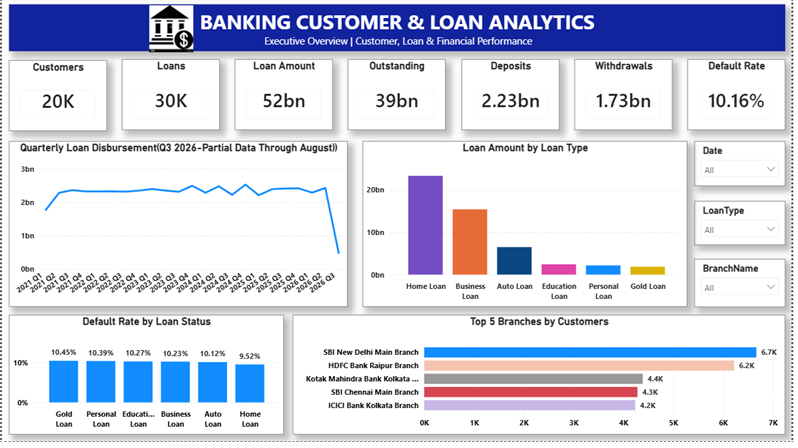
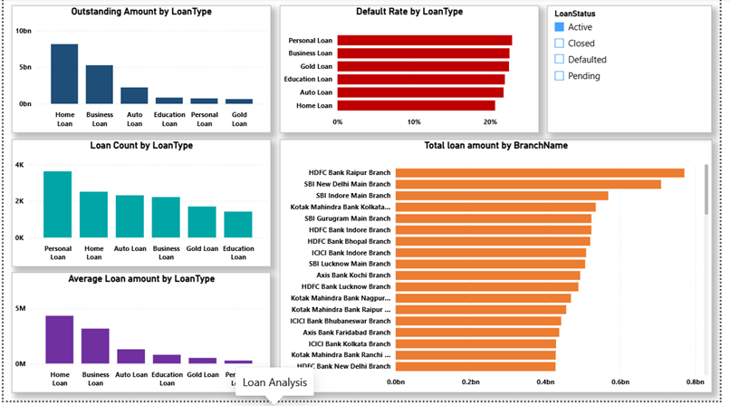
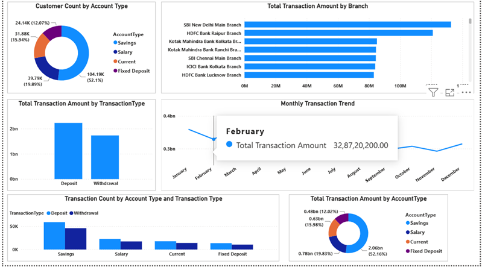

# Banking Customer & Loan Analytics Dashboard

## Project Overview
An interactive Power BI dashboard developed to analyze banking customers, loans, payments, and loan performance. The dashboard helps explore loan disbursement trends, customer distribution, payment activity, and loan defaults.

## Tools & Technologies
- Power BI Desktop
- SQL Server
- SQL
- DAX
- Power Query

## Project Objectives
- Analyze customer and loan information.
- Track loan disbursement trends over time.
- Monitor loan defaults and payment activity.
- Explore banking performance across branches.
- Present key metrics through interactive dashboards.

## Data Preparation
- Used SQL Server to prepare and validate project data.
- Performed data quality checks, including duplicate and NULL checks.
- Used Power Query for data preparation and transformation.
- Created relationships between relevant tables in the Power BI data model.

## Dashboard Features
- Key performance indicators for loan and customer analysis.
- Loan status and default rate analysis.
- Loan disbursement trends.
- Customer and branch-level analysis.
- Payment and loan performance insights.
- Interactive visuals and filters.

## Files
- `Banking Customer and Loan Analysis.pbix` — Power BI dashboard report.

## Project Type
Portfolio project using synthetic banking data for analytical and learning purposes.
## Dashboard Preview

### Page 1: Executive Overview

### Page 2: Loan Analysis

### Page 3: Customer & Payment Analysis

